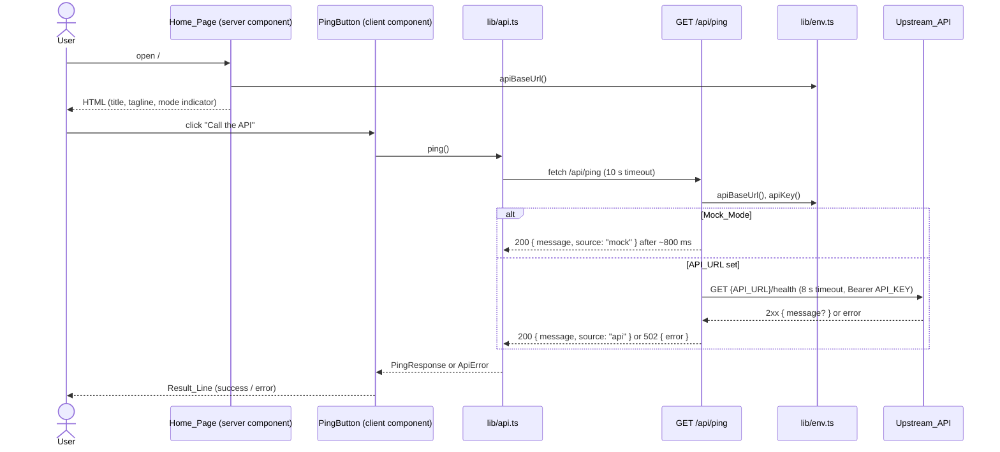

# Design Document

## Overview

The baseline is a single Next.js App Router page with one client component and one route handler. The browser only ever calls our own origin (`/api/*`); the route handler is the only code that talks to the Upstream_API, which keeps secrets on the server and gives one place to apply timeouts and the demo fallback.

## Architecture



- **Rendering:** `cacheComponents` is enabled. The Home_Page has no request-time data, so it is prerendered; the Ping_Route calls `connection()` so it always runs per request.
- **Hosting:** Vercel builds with `next build`. Static output and the route handler deploy without extra configuration.

## Components and Interfaces

### `app/page.tsx` (server component)
- Renders the title (Instrument Serif display), tagline, `PingButton`, the decorative accent disc (`aria-hidden`) and a footer showing Mock_Mode vs. live.
- Reads `apiBaseUrl()` to choose the mode label. It never passes the URL itself to the client.

### `components/ping-button.tsx` (client component)
- Local state: `Status = idle | loading | success(message) | error(message)`.
- Renders a native `<button>` with `aria-busy`, `disabled` while loading, and `aria-describedby="ping-result"`.
- Renders the Result_Line as `<p id="ping-result" aria-live="polite">`.

### `lib/api.ts` (browser)
```ts
class ApiError extends Error { status?: number }
type PingResponse = { message: string; source: 'api' | 'mock' };
function ping(): Promise<PingResponse>;
```
- `request<T>(path)` applies a 10 s `AbortSignal.timeout`, maps network failures and timeouts to readable `ApiError`s, and surfaces the route's `{ error }` message on non-2xx responses.

### `app/api/ping/route.ts`
```ts
export async function GET(): Promise<Response>;
```
- `await connection()`, then mock or forward as in the sequence above.

### `lib/env.ts` (server only)
```ts
function apiBaseUrl(): string | null; // trimmed, no trailing slash
function apiKey(): string | null;
```

## Data Models

| Shape | Fields | Used by |
| --- | --- | --- |
| `PingResponse` | `message: string`, `source: "api" \| "mock"` | Ping_Route success body, `ping()` result |
| Error body | `error: string` | Ping_Route non-2xx body |
| Environment | `API_URL?`, `API_KEY?` | `lib/env.ts` |

## Error Handling

| Failure | Where it's caught | What the user sees |
| --- | --- | --- |
| Browser offline / DNS failure | `request()` | "Network error. Check your connection and try again." |
| No response within 10 s | `request()` (`TimeoutError`) | "The request timed out. Try again." |
| Upstream unreachable or > 8 s | Ping_Route `catch` → 502 | "Could not reach the API. Check API_URL." |
| Upstream non-2xx | Ping_Route → 502 | "The API returned status N." |
| Upstream body not JSON / no `message` | Ping_Route | Success with "API is reachable." |

Upstream bodies, headers and stack traces never reach the browser.

## Testing Strategy

- **Static checks (every change):** `npm run typecheck`, `npm run lint`. The `typecheck-on-stop` hook runs the type check automatically at the end of each agent turn.
- **Build (before every push):** `npm run build` must pass and show `/api/ping` as dynamic (`ƒ`).
- **Manual checks:** on `npm run dev` and on the Vercel URL, click the button in Mock_Mode and with a real `API_URL`; check phone width, light and dark mode, and keyboard focus.
- **Optional automated tests:** unit tests for `request()` error mapping and the Ping_Route branches (see the optional tasks in `tasks.md`). They need a test runner, which is a new dependency to agree on first.
