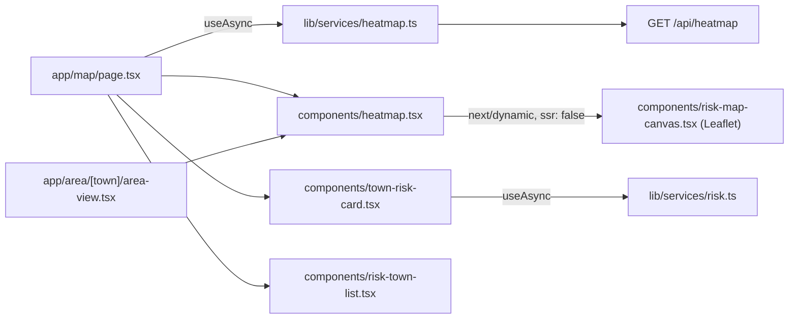

# Design Document

## Overview

A Leaflet map (react-leaflet 5) with Esri World Topo tiles: soft greens and pale water that fit the field-guide palette, and no API key. (CARTO basemaps now return "API key required" tiles.) Towns are sticker-style pins in the app's risk colors. `/map` adds filter chips, a Town_Card and a Town_List around the map; town pages get a static Map_Preview. The API contract does not change.

## Architecture



- Leaflet touches `window`, so `risk-map-canvas.tsx` loads through `next/dynamic` with `ssr: false` from the client component `heatmap.tsx`.
- Selection and filter state live in `app/map/page.tsx` and flow down as props.
- The map frame is 4:3 (Massachusetts is wide and short) and fits the view to the towns with data.
- The Town_Card renders directly under the map, so it never covers the selected pin; a "Tap a town" hint sits in the map's top-left corner while nothing is selected.
- The map wrapper uses `isolate` so Leaflet's z-indexes (400–1000) stay below the fixed bottom nav.

## Components and Interfaces

```ts
// components/heatmap.tsx (unchanged call sites keep working)
Heatmap(props: { points?: HeatmapPoint[]; compact?: boolean; selectedId?: string | null;
                 onSelect?: (townId: string) => void;
                 hint?: ReactNode;       // floats in the map's top-left corner
                 children?: ReactNode    // rendered right under the map (the Town_Card)
               } & SlotProps)

// components/risk-map-canvas.tsx (default export, browser only)
RiskMapCanvas(props: { points: HeatmapPoint[]; compact: boolean; selectedId: string | null;
                       onSelect?: (townId: string) => void })

// components/town-risk-card.tsx
TownRiskCard(props: { townId: string | null; onClose: () => void })

// components/risk-town-list.tsx
RiskTownList(props: { points: HeatmapPoint[] })

// components/map-utils.ts
riskFromIndex(value: number): RiskLevel   // ≥0.7 high, ≥0.4 moderate, else low
townName(id: string): string              // "north-adams" -> "North Adams"
```

- **Town_Pin:** a Leaflet `divIcon`: a 22 px dot with a white rim and soft shadow. From zoom 9 up, or when selected, it grows into a name tag. Each pin has an `sr-only` name ("Amherst, high risk") and is keyboard-focusable (`keyboard: true`). A translucent `Circle` (6–22 km, scaled by the index) under each pin shows the zone.
- **Selection:** tapping a pin calls `onSelect`. The canvas flies to the town (zoom ≥ 9), or jumps there under reduced motion.
- **Map_Preview:** `compact` turns off dragging, zoom, keyboard and pin interaction, so the surrounding `<Link href="/map">` gets the tap.

## Data Models

No new types. `HeatmapPoint { townId, lat, lng, value }` comes from `lib/types.ts`. Town names come from the slug until a `getTown(id)` service exists.

## Correctness Properties

### Property 1: Level follows the index
*For any* heatmap value v in [0, 1], `riskFromIndex(v)` is `high` when v ≥ 0.70, `moderate` when 0.40 ≤ v < 0.70, and `low` otherwise, and the pin, zone, Town_List row and filter all use that same level.
**Validates: Requirements 1.1, 3.2**

### Property 2: Filtering never loses or invents towns
*For any* set of points and any filter f, the visible towns are exactly the points whose level equals f (or all points for "All"), and the per-level filter counts sum to the total.
**Validates: Requirements 3.1, 3.2**

### Property 3: Selection is always visible
*For any* sequence of taps and filter changes, the selected town, if any, is one of the visible towns; a filter that hides it clears the selection.
**Validates: Requirements 2.1, 3.3**

### Property 4: List order
*For any* set of points, the Town_List is sorted by value, highest first, and contains each visible town exactly once.
**Validates: Requirements 4.1**

### Property 5: Town names round-trip from ids
*For any* kebab-case town id, `townName(id)` capitalizes each word and joins them with spaces, so "north-adams" becomes "North Adams".
**Validates: Requirements 2.2, 4.1**

## Error Handling

| Case | Behavior |
| --- | --- |
| Heatmap loading / error / empty | `slotStatus` (LoadingState, ErrorState with retry, EmptyState) |
| Leaflet bundle loading | Rounded placeholder with `LoadingState` "Loading map…" |
| Risk for the selected town fails | ErrorState inside the Town_Card with retry; the map keeps working |
| Tiles fail to load (e.g. provider outage) | Pins and zones still render on the plain background |

## Testing Strategy

- `npm run typecheck`, `npm run lint` (no new errors) and `npm run build`.
- In the browser at 393 px and desktop width: pins render; tap selects and fills the card; filters update the map and list; zooming shows names; the preview on `/area/amherst` opens `/map`; no console errors; the bottom nav stays above the map.
